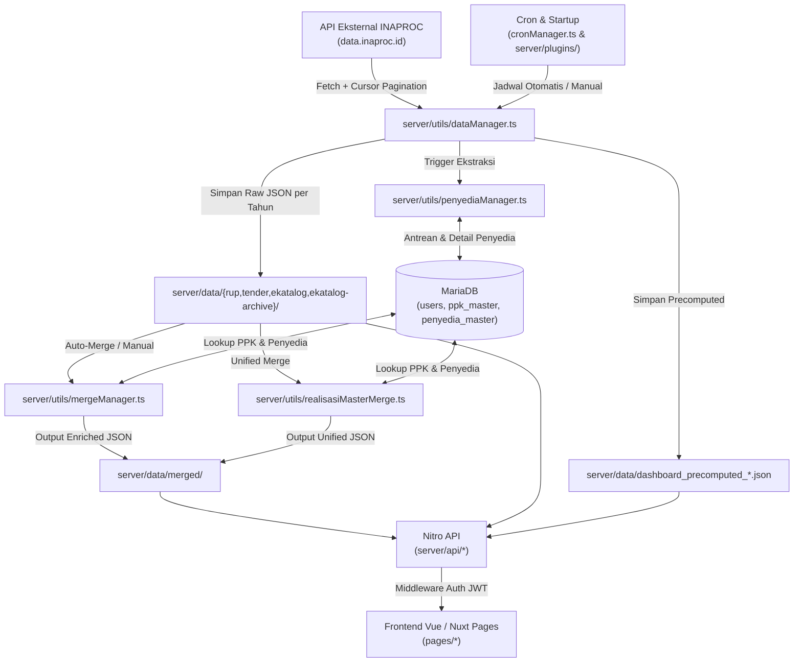

# Dokumentasi Teknis — Pengadaan Dashboard (`ukpbj-dashboard`)

Dokumen ini disusun sebagai **Developer Handover Guide** (acuan teknis) bagi programmer yang akan memelihara, mengembangkan, atau melanjutkan project **Pengadaan Dashboard**. Seluruh alur kerja dari hulu (penarikan data API INAPROC) hingga hilir (pengolahan, penggabungan, keamanan, dan penyajian di UI) dijelaskan secara rinci beserta lokasi file dan nama fungsinya.

---

## Daftar Isi
1. [Gambaran Umum & Tech Stack](#1-gambaran-umum--tech-stack)
2. [Instalasi, Environment & Skema Database](#2-instalasi-environment--skema-database)
3. [Peta Direktori & Lokasi File Penting](#3-peta-direktori--lokasi-file-penting)
4. [Daftar Lengkap Endpoint & Cara Memanggilnya](#4-daftar-lengkap-endpoint--cara-memanggilnya)
5. [Logic Mendapatkan Data (Data Acquisition & Caching)](#5-logic-mendapatkan-data-data-acquisition--caching)
6. [Logic Pengolahan & Penggabungan Data (Data Merging)](#6-logic-pengolahan--penggabungan-data-data-merging)
7. [Logic Menyajikan Data (API ke Frontend & Keamanan)](#7-logic-menyajikan-data-api-ke-frontend--keamanan)
8. [SOP Pengembangan Fitur / Endpoint Baru](#8-sop-pengembangan-fitur--endpoint-baru)
9. [Operasional: Backup, Restore & Deployment](#9-operasional-backup-restore--deployment)
10. [SSH Tunneling / Dynamic Port Forwarding (Akses Lokal API INAPROC)](#10-ssh-tunneling--dynamic-port-forwarding-akses-lokal-api-inaproc)

---

## 1. Gambaran Umum & Tech Stack

Project ini adalah aplikasi **Monolith Full-Stack** berbasis **Nuxt 4** (`nuxt: ^4.4.8`) dengan **Nitro Server Engine** sebagai backend API.

* **Frontend:** Vue 3 (`<script setup>` Composition API), Maz-UI (`@maz-ui/nuxt`), TailwindCSS, dan Chart.js (`vue-chartjs`).
* **Backend:** Nitro Server (`server/`), `node-cron` untuk penjadwalan sinkronisasi otomatis, `adm-zip` untuk backup/restore data JSON.
* **Penyimpanan Hibrida (Hybrid Storage):**
  1. **RAM (`memoryCache`):** Variabel objek di memori Nitro server untuk akses tercepat (`O(1)`).
  2. **File JSON Lokal (`server/data/`):** Menyimpan hasil tarikan data mentah (*raw*) per tahun anggaran dan hasil penggabungan data (*merged/enriched*).
  3. **Database MariaDB / MySQL (`mysql2/promise`):** Menyimpan data transaksional/master yang dikelola sistem: `users`, `ppk_master`, dan `penyedia_master`.
* **Autentikasi:** JWT (`jsonwebtoken`) yang disimpan di `HttpOnly` Cookie (`auth_token`) + cookie penanda sisi client (`is_logged_in`, `user_role`), serta enkripsi password menggunakan `bcryptjs`.



---

## 2. Instalasi, Environment & Skema Database

### A. Prasyarat & Menjalankan Project
* **Node.js:** `^20.0.0 || ^22.0.0`
* **Database:** MariaDB / MySQL (default dev menggunakan database `pengadaan` di `localhost` dengan user `root` tanpa password, dapat disesuaikan di `server/utils/db.ts`).

```bash
# 1. Install dependencies
npm install

# 2. Jalankan mode development (http://localhost:3000)
npm run dev

# 3. Build untuk production
npm run build
npm run preview
```

### B. Variabel Environment (`.env`)
Konfigurasi runtime dibaca di `nuxt.config.ts` (`runtimeConfig`) dan langsung dari `process.env` pada beberapa utilitas server:

| Variabel | Kegunaan | Dipakai Di |
| :--- | :--- | :--- |
| `INPROC_API` | Base URL API eksternal INAPROC (contoh: `https://data.inaproc.id/api/v1`) | `dataManager.ts`, `penyediaManager.ts` |
| `API_DATA_TOKEN` | Bearer Token rahasia untuk mengakses API INAPROC | `nuxt.config.ts`, `dataManager.ts`, `penyediaManager.ts` |
| `API_DATA_KODE_KLPD` | Kode KLPD instansi (contoh: `K22`) | `nuxt.config.ts`, `dataManager.ts` |
| `API_DATA_JENIS` | Parameter `jenis` default untuk endpoint dashboard API (contoh: `1`) | `nuxt.config.ts`, `dataManager.ts`, `dashboard.get.ts` |
| `JWT_SECRET` | Secret key untuk menandatangani & memverifikasi JWT `auth_token` | `nuxt.config.ts`, `login.post.ts`, `server/middleware/auth.ts` |
| `NUXT_PUBLIC_NAMA_INSTANSI` | Nama instansi yang ditampilkan di UI publik | `nuxt.config.ts` |
| `DB_HOST_PROD`, `DB_USER_PROD`, `DB_PASSWORD_PROD`, `DB_NAME_PROD` | Kredensial MariaDB saat `NODE_ENV === 'production'` | `server/utils/db.ts` |
| `INAPROC_PROXY_URL` | URL SOCKS5 proxy lokal untuk routing request API INAPROC lewat SSH tunnel (contoh: `socks5://127.0.0.1:10808`). **Jangan diaktifkan di production Hostinger.** | `server/utils/inaprocFetch.ts` |
| `USE_DEMO_DATA` | Jika `'true'`, memakai folder `server/data_demo` alih-alih `server/data` | `server/utils/dataDir.ts`, `penyediaManager.ts`, `ppkManager.ts` |

### C. Skema Database MariaDB (`server/utils/db.ts`)
Tabel otomatis dibuat oleh fungsi `initDB()` jika belum ada:

1. **`users`** (dikelola oleh `server/utils/userManager.ts`):
   * `id` (`VARCHAR(255) PK`), `username` (`VARCHAR(255) UNIQUE`), `passwordHash` (`VARCHAR(255)`), `role` (`VARCHAR(50)`).
   * *Catatan:* Jika tabel kosong saat startup, `ensureDefaultUser()` otomatis membuat akun default `admin`.
2. **`ppk_master`** (dikelola oleh `server/utils/ppkManager.ts`):
   * `id` (`INT AUTO_INCREMENT PK`), `nip_nama_masked` (`VARCHAR(255) UNIQUE`), `nama_lengkap`, `nip_asli`, `jabatan`, `unit_kerja`, `telepon`, `email`, `created_at`, `updated_at`.
   * Digunakan untuk melengkapi nama/NIP PPK yang di-masking oleh API INAPROC.
3. **`penyedia_master`** (dikelola oleh `server/utils/penyediaManager.ts`):
   * `kode_penyedia` (`VARCHAR(255) PK`), `nama_penyedia`, `npwp`, `alamat`, `telepon`, `email`, `jenis_perusahaan`, `bentuk_usaha`, `status_umkk` (`INT`), `status_aktif`, `nib`, `status_api` (`ENUM('PENDING', 'SUCCESS', 'FAILED')`), `retry_count` (`INT`), `created_at`, `updated_at`.

---

## 3. Peta Direktori & Lokasi File Penting

### A. Lokasi Folder Data (`server/data/`)
Seluruh data cache, konfigurasi dinamis, dan hasil penggabungan tersimpan di `server/data/`:

```text
server/data/
├── rup/                                  # Raw data RUP per tahun (format: {endpoint}_{tahun}.json)
│   ├── paket-penyedia_{tahun}.json
│   ├── paket-swakelola_{tahun}.json
│   ├── paket-swakelola-terumumkan_{tahun}.json
│   ├── paket-anggaran-penyedia_{tahun}.json
│   ├── paket-anggaran-swakelola_{tahun}.json
│   ├── master-satker_{tahun}.json
│   ├── history-kaji-ulang_{tahun}.json
│   └── program-master_{tahun}.json
├── tender/                               # Raw data Tender, Non-Tender & Pencatatan
│   ├── pengumuman_{tahun}.json
│   ├── peserta-tender_{tahun}.json
│   ├── non-tender-pengumuman_{tahun}.json
│   ├── pencatatan-non-tender_{tahun}.json
│   ├── pencatatan-non-tender-realisasi_{tahun}.json
│   ├── pencatatan-swakelola_{tahun}.json
│   └── pencatatan-swakelola-realisasi_{tahun}.json
├── ekatalog/                             # Raw data e-Katalog V6
│   └── paket-e-purchasing_{tahun}.json
├── ekatalog-archive/                     # Raw data e-Katalog Archive V5
│   └── paket-e-purchasing_{tahun}.json
├── merged/                               # Output data olahan/gabungan internal (bukan dari API langsung)
│   ├── nontender_enriched_{tahun}.json
│   ├── rup-penyedia-enriched_{tahun}.json
│   ├── rup-swakelola-enriched_{tahun}.json
│   ├── pencatatan-nontender-enriched_{tahun}.json
│   ├── pencatatan-swakelola-enriched_{tahun}.json
│   ├── epurchasing_enriched_{tahun}.json
│   └── realisasi_master_{tahun}.json
├── dashboard_precomputed_{tahun}_{instansi}.json               # Cache dashboard publik
├── dashboard_precomputed_{tahun}_{instansi}_satker_{id}.json   # Cache dashboard internal satker
├── endpoints_config.json                 # Daftar endpoint aktif (mengontrol sync & visibilitas menu)
├── cron_config.json                      # Jadwal cron & toggle aktif/nonaktif cron
├── endpoint_logs.json                    # Log status & jumlah record sinkronisasi terakhir
└── merge_history.json                    # Riwayat 50 eksekusi merge terakhir & anomali
```

### B. Lokasi File Logic Backend (`server/`)
* **`server/plugins/cron.ts`:** Inisialisasi startup (`loadEndpointsConfig()`, `reloadCronJob()`), serta memicu `triggerSyncAll()` otomatis jika data wajib tahun berjalan belum tersedia.
* **`server/plugins/initMergeRealisasi.ts`:** Otomatis menjalankan `executeRealisasiMasterMerge(currentYear, 'startup')` di latar belakang saat server menyala.
* **`server/middleware/auth.ts`:** Penjaga seluruh rute `/api/*` (validasi JWT cookie `auth_token`, kecuali daftar `publicApiPaths`).
* **`server/utils/`:**
  * `dataManager.ts`: Penarikan API INAPROC, retry/timeout, 3-tier cache, dan dashboard precomputed.
  * `cronManager.ts`: Master `endpointRegistry`, penjadwalan `node-cron`, logging, dan konfigurasi endpoint aktif.
  * `mergeManager.ts`: Engine penggabungan data untuk 6 dataset *enriched* + `triggerAutoMerge` (*debounce* 5 detik).
  * `realisasiMasterMerge.ts`: Engine penggabungan lintas transaksi menjadi `realisasi_master_{tahun}.json` + *auto-invalidation* berbasis timestamp file.
  * `realisasiMergeManager.ts`: Versi legacy/alternatif cache realisasi (`server/data/cache/realisasi_{tahun}.json`).
  * `penyediaManager.ts`: Ekstraksi kode penyedia & antrean pemanggilan API detail penyedia.
  * `ppkManager.ts`: Ekstraksi NIP/Nama PPK ter-masking & CRUD master PPK ke MariaDB.
  * `userManager.ts` & `db.ts`: Koneksi pool MariaDB, inisialisasi tabel, dan manajemen user.

### C. Lokasi Halaman & Komponen Frontend
* **`pages/dashboard.vue` & `pages/public-dashboard.vue`:** Halaman ringkasan eksekutif (Private & Publik), menggunakan komponen di `components/dashboard/`.
* **`pages/rup/`, `pages/tender/`, `pages/ekatalog/`:** Halaman penampil **raw data** murni dari API.
* **`pages/summary-table/`:** Halaman penampil **enriched / merged data** lengkap dengan analitik & dialog detail (komponen di `components/summary-table/`).
* **`pages/admin/`:** Halaman administrasi: `system.vue` (cron, sync, backup/import, toggle endpoint), `data-merge.vue` (kontrol merge manual & log anomali via komponen `components/admin/Merge*.vue`), `ppk-master.vue`, `penyedia-master.vue`.
* **`pages/users/index.vue`:** Manajemen pengguna (khusus role `admin`).
* **`components/layout/menu.ts` & `layouts/default.vue`:** Konfigurasi navigasi sidebar dan pengecekan `endpointActive`.
* **`middleware/auth.global.ts`:** Guard navigasi sisi client berdasarkan cookie `is_logged_in` dan `user_role`.

---

## 4. Daftar Lengkap Endpoint & Cara Memanggilnya

### A. Letak Master Daftar Endpoint Eksternal (INAPROC)
Daftar seluruh endpoint eksternal yang ditarik oleh sistem berada di **`server/utils/cronManager.ts`** pada konstanta **`endpointRegistry`** (baris 9–38), dan status aktif/nonaktifnya disimpan di **`server/data/endpoints_config.json`**.

Format URL eksternal yang dipanggil oleh `syncEndpointData(group, endpoint, tahun)` di `server/utils/dataManager.ts` adalah:
```text
GET {INPROC_API}/{group}/{endpoint}?tahun={tahun}&kode_klpd={API_DATA_KODE_KLPD}&cursor={cursor}
Header: Authorization: Bearer {API_DATA_TOKEN}
```

Daftar lengkap di `endpointRegistry`:

| Group | Endpoint | Keterangan | Output File Lokal |
| :--- | :--- | :--- | :--- |
| `dashboard` | `profil-precomputed` | Endpoint khusus: `https://data.inaproc.id/api/v1/dashboard/profil/precomputed` | `server/data/dashboard_precomputed_{tahun}_{instansi}*.json` |
| `rup` | `program-master` | Daftar program master RUP | `server/data/rup/program-master_{tahun}.json` |
| `rup` | `history-kaji-ulang` | Riwayat kaji ulang paket RUP | `server/data/rup/history-kaji-ulang_{tahun}.json` |
| `rup` | `master-satker` | Daftar satuan kerja | `server/data/rup/master-satker_{tahun}.json` |
| `rup` | `paket-anggaran-penyedia` | Pagu anggaran paket penyedia | `server/data/rup/paket-anggaran-penyedia_{tahun}.json` |
| `rup` | `paket-anggaran-swakelola` | Pagu anggaran paket swakelola | `server/data/rup/paket-anggaran-swakelola_{tahun}.json` |
| `rup` | `paket-penyedia` | Detail paket penyedia, PPK, dan metode | `server/data/rup/paket-penyedia_{tahun}.json` |
| `rup` | `paket-swakelola` | Detail paket swakelola | `server/data/rup/paket-swakelola_{tahun}.json` |
| `rup` | `paket-swakelola-terumumkan` | Paket swakelola yang sudah diumumkan | `server/data/rup/paket-swakelola-terumumkan_{tahun}.json` |
| `tender` | `pengumuman` | Pengumuman paket tender | `server/data/tender/pengumuman_{tahun}.json` |
| `tender` | `peserta-tender` | Daftar peserta dan pemenang tender | `server/data/tender/peserta-tender_{tahun}.json` |
| `tender` | `non-tender-pengumuman` | Pengumuman paket non-tender | `server/data/tender/non-tender-pengumuman_{tahun}.json` |
| `tender` | `pencatatan-non-tender` | Daftar pencatatan paket non-tender | `server/data/tender/pencatatan-non-tender_{tahun}.json` |
| `tender` | `pencatatan-non-tender-realisasi` | Realisasi pencatatan non-tender | `server/data/tender/pencatatan-non-tender-realisasi_{tahun}.json` |
| `tender` | `pencatatan-swakelola` | Daftar pencatatan paket swakelola | `server/data/tender/pencatatan-swakelola_{tahun}.json` |
| `tender` | `pencatatan-swakelola-realisasi` | Realisasi pencatatan swakelola | `server/data/tender/pencatatan-swakelola-realisasi_{tahun}.json` |
| `ekatalog` | `paket-e-purchasing` | Paket e-Purchasing e-Katalog V6 | `server/data/ekatalog/paket-e-purchasing_{tahun}.json` |
| `ekatalog-archive` | `paket-e-purchasing` | Arsip e-Katalog Versi 5 | `server/data/ekatalog-archive/paket-e-purchasing_{tahun}.json` |

*Endpoint eksternal tambahan (dipanggil oleh `penyediaManager.ts`):*
* `GET {INPROC_API}/ekatalog/penyedia-detail?kode_penyedia={kode}` (dengan header `Authorization: Bearer {token}`).

---

### B. Daftar Endpoint Internal Nitro API (`server/api/`) & Cara Memanggilnya

Frontend **tidak pernah** memanggil API INAPROC secara langsung. Semua request dari Vue/Nuxt memanggil endpoint internal Nitro berikut (via `$fetch`):

#### 1. Endpoint Publik (Tanpa Login / Dikecualikan di `server/middleware/auth.ts`)
| Method & Path | Handler File | Parameter Query / Body | Kegunaan |
| :--- | :--- | :--- | :--- |
| `POST /api/auth/login` | `server/api/auth/login.post.ts` | Body: `{ username, password }` | Login & set cookie `auth_token` (`HttpOnly`) |
| `GET /api/dashboard` | `server/api/dashboard.get.ts` | Query: `tahun`, `instansi` (wajib), `jenis`, `view`, `eselon`, `satker` | Data ringkasan dashboard precomputed |
| `GET /api/summary-table/realisasi-publik` | `server/api/summary-table/realisasi-publik.get.ts` | Query: `tahun`, `page`, `limit`, `search`, `sumberTransaksi`, `metodePengadaan` | Tabel realisasi publik (field `nama_ppk`, `nama_penyedia`, `_sort_date` dihapus) |
| `GET /api/summary-table/realisasi-analytics-publik` | `server/api/summary-table/realisasi-analytics-publik.get.ts` | Query: `tahun` | Agregasi grafik tren bulanan & pie chart realisasi publik |

#### 2. Endpoint Raw Data (Memerlukan Login)
* **`GET /api/data/[group]/[endpoint]`** (`server/api/data/[group]/[endpoint].get.ts`)
  * **Contoh pemanggilan dari Frontend:**
    ```ts
    const res = await $fetch('/api/data/rup/paket-penyedia', {
      params: {
        tahun: '2026',
        page: 1,
        limit: 25,
        search: 'laptop',
        filterAktif: 'true',       // opsional: 'true' | 'false' | 'ALL'
        filterUmumkan: 'Sudah',    // opsional
        forceRefresh: 'false'      // 'true' untuk memaksa tarik ulang dari API INAPROC
      }
    });
    ```
  * **Parameter filter yang didukung:** `filterAktif`, `filterDelete`, `filterUmumkan`, `filterDate`, `filterJenisRevisi`, `filterStatusNontender`, `filterStatusTender`, `filterMtdPemilihan`, `filterSatker`, `filterPemenang`, `filterStatus`, `filterShipmentStatus`, `filterFundingSource`.
  * **Response:** `{ success, data, meta: { page, limit, totalItems, totalPages, totalAllItems }, filterOptions }`.

#### 3. Endpoint Enriched / Summary Table (Memerlukan Login)
* **Data Tabel Enriched (`server/api/data/merged/`):**
  * `GET /api/data/merged/nontender-enriched` (`?tahun=&page=&limit=&search=&filterMetode=&filterRupMatch=&filterPpkComplete=&filterNamaPpk=&filterStatusNontender=&filterSatker=`)
  * `GET /api/data/merged/pencatatan-nontender-enriched`
  * `GET /api/data/merged/pencatatan-swakelola-enriched`
  * `GET /api/data/merged/rup-swakelola-enriched`
* **Summary Table & Analytics (`server/api/summary-table/`):**
  * `GET /api/summary-table/rup-penyedia-enriched` (`?tahun=&page=&limit=&search=&jenisPengadaan=&metodePengadaan=&statusRealisasi=&sumberDana=&ppk=&statusUmumkan=`)
  * `GET /api/summary-table/epurchasing`
  * `GET /api/summary-table/realisasi-private` (Mendukung filter lengkap: `filterType` (`semua`|`tanggal`|`triwulan`), `startDate`, `endDate`, `selectedQuarter`, `sumberTransaksi`, `metodePengadaan`, `ppk`, `penyedia`, `sumberDana`, `jenisPengadaan`, `statusPaket`, `tahapanPengadaan`. Jika `limit >= 100000`, mengembalikan seluruh data untuk keperluan export).
  * `GET /api/summary-table/realisasi-analytics-private`
  * `GET /api/summary-table/analytics-summary`
  * `GET /api/summary-table/epurchasing-analytics-summary`
  * `GET /api/summary-table/nontender-analytics-summary`
  * `GET /api/summary-table/pencatatan-analytics-summary`
  * `GET /api/summary-table/rup-swakelola-analytics-summary`
  * `GET /api/summary-table/swakelola-analytics-summary`

#### 4. Endpoint Administrasi & Manajemen User (Memerlukan Login)
* **Sinkronisasi, Cron & Sistem (`server/api/admin/`):**
  * `GET /api/admin/system-stats` — Statistik ukuran RAM cache, jumlah file JSON, & ukuran disk.
  * `GET /api/admin/cron` & `POST /api/admin/cron` — Baca/simpan jadwal cron (`schedule`, `enableMainCron`, `enablePenyedia`).
  * `POST /api/admin/cron-sync` — Memicu sinkronisasi seluruh endpoint aktif di latar belakang (`triggerSyncAll()`).
  * `GET /api/admin/endpoints-config` & `POST /api/admin/endpoints-config` — Baca/simpan daftar endpoint aktif (`activeEndpoints`).
  * `GET /api/admin/data-backup` — Download seluruh folder `server/data/` sebagai file `.zip`.
  * `POST /api/admin/data-import` — Upload `.zip` backup (multipart form-data field `file`) untuk menimpa `server/data/`.
* **Kontrol Merge Data (`server/api/admin/`):**
  * `POST /api/admin/merge` & `GET /api/admin/merge-status` (Non-Tender)
  * `POST /api/admin/merge-rup-penyedia` & `GET /api/admin/merge-rup-penyedia-status`
  * `POST /api/admin/merge-rup-swakelola` & `GET /api/admin/merge-rup-swakelola-status`
  * `POST /api/admin/merge-pencatatan-nontender` & `GET /api/admin/merge-pencatatan-nontender-status`
  * `POST /api/admin/merge-pencatatan-swakelola` & `GET /api/admin/merge-pencatatan-swakelola-status`
  * `POST /api/admin/merge-epurchasing` & `GET /api/admin/merge-epurchasing-status`
  * `POST /api/admin/merge-realisasi-master` & `GET /api/admin/merge-realisasi-status`
* **Master PPK & Penyedia (`server/api/admin/`):**
  * `GET /api/admin/ppk-master`, `POST /api/admin/ppk-master`, `DELETE /api/admin/ppk-master`
  * `GET /api/admin/penyedia-master`, `POST /api/admin/process-penyedia`, `POST /api/admin/toggle-penyedia-cron`
* **Users (`server/api/users/`):**
  * `GET /api/users`, `POST /api/users`, `PUT /api/users/[id]`, `DELETE /api/users/[id]`

---

## 5. Logic Mendapatkan Data (Data Acquisition & Caching)

Seluruh mekanisme penarikan data berada di **`server/utils/dataManager.ts`** dan **`server/utils/cronManager.ts`**.

### A. Mekanisme Fallback 3 Lapis (`getEndpointData`)
Saat sebuah API meminta data melalui `getEndpointData(group, endpoint, tahun, extraParams, forceRefresh)`:
1. **Lapis 1 — RAM (`memoryCache`):** Jika `!forceRefresh` dan `memoryCache["{group}_{endpoint}_{tahun}"]` tersedia, langsung kembalikan dari RAM.
2. **Lapis 2 — File JSON Lokal:** Jika tidak ada di RAM, baca `server/data/{group}/{endpoint}_{tahun}.json`. Jika berhasil di-parse, simpan ke `memoryCache` lalu kembalikan.
3. **Lapis 3 — Fetch API Eksternal (`syncEndpointData`):** Jika file tidak ditemukan (`ENOENT`) atau `forceRefresh === true`, panggil `syncEndpointData()`.
   * *Pengecualian:* Jika `group === 'merged'`, `getEndpointData()` **tidak pernah** memanggil API eksternal dan langsung mengembalikan `[]`.

### B. Cursor-Based Pagination & Ketahanan Fetch (`syncEndpointData` & `fetchWithRetry`)
* **Cursor Loop:** `syncEndpointData` melakukan `while (hasMore)` dengan parameter `tahun`, `kode_klpd`, dan `cursor`. Looping berhenti jika `response.meta?.has_more` (atau `response.has_more`) bernilai `false` / `'false'`, atau jika `cursor` berikutnya kosong.
* **Resilient Fetch (`fetchWithRetry`):**
  * Timeout `30.000 ms` (`AbortSignal.timeout`).
  * Maksimal `3` kali percobaan dengan *exponential backoff* (`5s -> 10s -> 20s`). Client error `4xx` tidak di-retry.
  * `validateJsonResponse`: Menolak response jika berupa HTML (API INAPROC terkadang mengembalikan halaman HTML saat timeout internal) agar cache JSON tidak tertimpa data rusak.
* **Post-Sync Hooks:** Setelah `fetchSuccess === true` dan file tersimpan:
  * Jika `isMergeSourceEndpoint(group, endpoint)` bernilai `true`, sistem otomatis memanggil `triggerAutoMerge(tahun, ...)`.
  * Jika `group === 'ekatalog' && endpoint === 'paket-e-purchasing'`, sistem memanggil `extractAndSavePenyedia(tahun)` untuk mengisi antrean `penyedia_master`.

### C. Penjadwalan Cron (`cronManager.ts`) & Antrean Penyedia (`penyediaManager.ts`)
* **Main Cron:** Default berjalan pada `0 6,12 * * *` (pukul 06:00 dan 12:00 WIB, `Asia/Jakarta`). Menarik seluruh endpoint aktif di `activeEndpoints` untuk **tahun berjalan** dan **tahun sebelumnya** (`currentYear - 1`), lalu mencatat hasilnya ke `server/data/endpoint_logs.json`.
* **Penyedia Queue Cron:** Berjalan setiap 15 menit (`*/15 * * * *`). Fungsi `processPenyediaQueue()` mengambil maksimal `10` record dari tabel `penyedia_master` yang berstatus `PENDING` atau `FAILED` (dengan `retry_count < 3`), memanggil `/ekatalog/penyedia-detail`, memperbarui MariaDB, dan jika ada yang sukses, memicu `triggerAutoMerge()` untuk tahun berjalan dan tahun lalu.

---

## 6. Logic Pengolahan & Penggabungan Data (Data Merging)

Penggabungan data mentah menjadi data siap saji (*enriched*) dilakukan secara internal di server melalui dua modul utama:

### A. 6 Pipeline Enriched Data (`server/utils/mergeManager.ts`)
Semua fungsi merge menggunakan **Hash Map Lookup (`new Map()`)** agar kompleksitas penggabungan tetap `O(1)` per record. Fungsi `triggerAutoMerge(tahun, trigger)` menggunakan **debounce 5 detik** sehingga jika beberapa endpoint selesai sync beruntun, merge hanya dijalankan sekali di akhir.

| Fungsi Eksekusi | File Sumber Utama | Data Pengaya (Lookup) & Join Key | Output File (`server/data/merged/`) |
| :--- | :--- | :--- | :--- |
| `executeMerge` | `tender/non-tender-pengumuman` | RUP Penyedia (`kd_rup`), Master Satker (`kd_satker`), Kaji Ulang (`kd_rup_baru/lama`), Anggaran Penyedia (`kd_rup`), PPK Master (`nip_nama_masked`) | `nontender_enriched_{tahun}.json` |
| `executeRupPenyediaMerge` | `rup/paket-penyedia` | Master Satker (`kd_satker`), PPK Master (`nip_ppk - nama_ppk`), Anggaran (`kd_rup`), Kaji Ulang (`kd_rup`), Paket Swakelola (`kd_rup_swakelola`), Non-Tender (`kd_rup`), E-Purchasing (`rup_code`), Penyedia (`kode_penyedia`) | `rup-penyedia-enriched_{tahun}.json` |
| `executeRupSwakelolaMerge` | `rup/paket-swakelola` | Master Satker (`kd_satker`), PPK Master, Anggaran Swakelola (`kd_rup`), Kaji Ulang (`kd_rup`), Anak Paket Penyedia (`kd_rup_swakelola`), Pencatatan Swakelola (`kd_rup`) | `rup-swakelola-enriched_{tahun}.json` |
| `executePencatatanNonTenderMerge` | `tender/pencatatan-non-tender` | Realisasi Non-Tender (`kd_nontender_pct`) + Penyedia Master (via `npwp` yang dibersihkan), RUP Penyedia (`kd_rup`), Master Satker, PPK Master | `pencatatan-nontender-enriched_{tahun}.json` |
| `executePencatatanSwakelolaMerge` | `tender/pencatatan-swakelola` | Realisasi Swakelola (`kd_swakelola_pct`), RUP Swakelola (`kd_rup`), Master Satker, PPK Master | `pencatatan-swakelola-enriched_{tahun}.json` |
| `executeEPurchasingMerge` | `ekatalog/paket-e-purchasing` | RUP Penyedia (`rup_code`), PPK Master (via `rup.nip_ppk - rup.nama_ppk`), Penyedia Master (`kode_penyedia`) | `epurchasing_enriched_{tahun}.json` |

### B. Unified Realisasi Master (`server/utils/realisasiMasterMerge.ts`)
Fungsi `executeRealisasiMasterMerge(tahun, trigger)` menyatukan **6 sumber transaksi** ke dalam satu skema seragam (`realisasi_master_{tahun}.json`) untuk halaman **Realisasi Pengadaan** dan **Dashboard Publik**:
1. **E-Katalog V6** (`ekatalog/paket-e-purchasing`): Filter status `COMPLETED`, `ON_PROCESS`, `PAYMENT_OUTSIDE_SYSTEM`.
2. **E-Katalog Archive V5** (`ekatalog-archive/paket-e-purchasing`).
3. **Pencatatan Non Tender** (`tender/pencatatan-non-tender` + `realisasi`): Kecuali status mengandung `BATAL`.
4. **Non Tender Pengumuman** (`tender/non-tender-pengumuman`): Filter `status_nontender === 'Selesai'`.
5. **Tender Pengumuman** (`tender/pengumuman`): Filter `status_tender === 'Selesai'`.
6. **Pencatatan Swakelola** (`tender/pencatatan-swakelola`): Kecuali status mengandung `BATAL`.

**Mekanisme Auto-Invalidation (`getRealisasiMasterData(tahun)`):**
Setiap kali API realisasi dipanggil, `getRealisasiMasterData` mengecek `mtimeMs` (waktu modifikasi terakhir) dari `realisasi_master_{tahun}.json` dibandingkan seluruh 11 file sumbernya. Jika file hasil merge belum ada, kosong, atau lebih tua dari salah satu file sumber, sistem **otomatis menjalankan `executeRealisasiMasterMerge(tahun, 'auto')`** sebelum mengembalikan data.

---

## 7. Logic Menyajikan Data (API ke Frontend & Keamanan)

### A. Prinsip Separation of Concerns (Pemisahan Halaman)
* **Halaman Raw Data (`pages/rup/*`, `pages/tender/*`, `pages/ekatalog/*`):** Hanya menampilkan data mentah dari `/api/data/[group]/[endpoint]`. Jangan mencampurkan logika merge di halaman ini.
* **Halaman Enriched / Rekapitulasi (`pages/summary-table/*`):** Menampilkan data hasil penggabungan, lengkap dengan tab **Analytics** (Chart.js) dan **Data Table** (filter multi-kolom, server-side pagination, dialog detail). Komponen UI berada di `components/summary-table/<nama-modul>/`.

### B. Keamanan & Pemisahan Data Publik vs Private
1. **Server Middleware (`server/middleware/auth.ts`):**
   * Semua request ke `/api/*` yang tidak ada di `publicApiPaths` wajib membawa cookie `auth_token` (JWT valid). Jika tidak, server mengembalikan `401 Unauthorized`.
2. **Client Middleware (`middleware/auth.global.ts`):**
   * Halaman selain `/`, `/login`, dan `/public-dashboard` dicek menggunakan cookie `is_logged_in`. Rute `/users/*` dibatasi khusus untuk `user_role === 'admin'`.
3. **Sanitasi Data Publik:**
   * API `realisasi-publik.get.ts` membuang properti sensitif (`nama_ppk`, `nama_penyedia`) dan properti internal (`_sort_date`) sebelum mengirim response ke client, sedangkan `realisasi-private.get.ts` mengirim data lengkap beserta filter PPK, Penyedia, dan rentang tanggal/triwulan.

### C. Kontrol Menu Sidebar (`components/layout/menu.ts`)
* Menu di sidebar dikelompokkan dalam `standaloneMenuItems` dan `menuGroups`.
* Item pada grup **Data API** memiliki properti `endpointActive` (contoh: `endpointActive: 'paket-penyedia'`). Jika admin menonaktifkan endpoint tersebut di halaman **Sistem & Cache** (tersimpan di `server/data/endpoints_config.json`), maka menu tersebut otomatis disembunyikan oleh layout.
* Item di grup **Admin** memiliki flag `adminOnly: true`.

---

## 8. SOP Pengembangan Fitur / Endpoint Baru

Ikuti daftar periksa ini setiap kali menambahkan endpoint API INAPROC baru atau fitur *Data Merge* baru (mengacu pada standar project di `.cursorrules`):

### A. Menambah Endpoint Raw API Baru
1. **Blueprint (Opsional/Disarankan):** Simpan contoh response JSON ke `blueprint/api_responses/[group]/[nama-endpoint].json`.
2. **Registrasi Backend:** Daftarkan `{ endpoint, label, description }` ke dalam `endpointRegistry` di **`server/utils/cronManager.ts`**.
3. **Aktivasi Config:** Tambahkan nama endpoint ke grup yang sesuai di **`server/data/endpoints_config.json`** (atau aktifkan lewat UI Admin -> Sistem & Cache).
4. **Buat Halaman Frontend:** Buat file **`pages/[group]/[endpoint].vue`** yang memanggil `/api/data/[group]/[endpoint]` menggunakan komponen Maz-UI & TailwindCSS.
5. **Registrasi Menu:** Tambahkan item menu baru beserta `endpointActive` di **`components/layout/menu.ts`**.

### B. Menambah Pipeline Merge / Enriched Data Baru
1. **Logika Merge:** Tambahkan fungsi `execute[Name]Merge(tahun, trigger)` di **`server/utils/mergeManager.ts`** (simpan output ke `server/data/merged/[name]-enriched_{tahun}.json`). Jika berkaitan dengan auto-merge, daftarkan sumbernya di `MERGE_SOURCE_ENDPOINTS` dan panggil fungsinya di dalam `triggerAutoMerge()`.
2. **API Kontrol Admin:** Buat `server/api/admin/merge-[name].post.ts` dan `server/api/admin/merge-[name]-status.get.ts`.
3. **UI Admin:** Buat komponen `components/admin/Merge[Name].vue` dan tambahkan sebagai tab baru di `pages/admin/data-merge.vue`.
4. **API & Halaman Penyajian:** Buat API penyajian dengan server-side pagination/filtering di `server/api/data/merged/` atau `server/api/summary-table/`, lalu buat halaman tampilannya di `pages/summary-table/`.

---

## 9. Operasional: Backup, Restore & Deployment

* **Backup Data JSON:** Melalui halaman Admin **Sistem & Cache** (`/admin/system`) atau memanggil `GET /api/admin/data-backup`. Seluruh isi `server/data/` akan dikompresi menjadi file `.zip`.
* **Restore / Import Data:** Upload file `.zip` melalui UI Admin atau `POST /api/admin/data-import`. Sistem akan mengekstrak ke `server/data/` dan menginvalidasi cache PPK (`invalidatePpkCache()`). *Catatan:* Data `users`, `ppk_master`, dan `penyedia_master` berada di MariaDB sehingga perlu di-backup terpisah (misal via `mysqldump`).
* **Deployment Production:**
  1. Pastikan `.env` di server production sudah terisi lengkap (termasuk `DB_HOST_PROD`, `DB_USER_PROD`, `DB_PASSWORD_PROD`, `DB_NAME_PROD`, `JWT_SECRET`, `INPROC_API`, `API_DATA_TOKEN`, `API_DATA_KODE_KLPD`). Pastikan `INAPROC_PROXY_URL` **tidak diset / dikomentari** di server production.
  2. Jalankan `npm run build`.
  3. Jalankan server Nitro hasil build (`node .output/server/index.mjs`) dengan process manager seperti PM2, serta pastikan folder `server/data/` memiliki izin tulis (*write permission*) agar cron sync dan merge dapat menyimpan file JSON.

---

## 10. SSH Tunneling / Dynamic Port Forwarding (Akses Lokal API INAPROC)

API eksternal INAPROC (`data.inaproc.id`) menerapkan pembatasan IP (*IP Whitelisting*), sehingga akses langsung dari IP internet laptop/kantor saat development lokal bisa ditolak. Untuk mengatasinya tanpa harus selalu deploy ke server, kita memanfaatkan **SSH Tunneling** melalui server Hostinger yang IPv4-nya sudah di-*whitelist*.

### A. Apa Itu SSH Tunneling & Dynamic Port Forwarding?

* **SSH Tunneling:** Membuat jalur komunikasi terenkripsi antara laptop lokal dan server remote (Hostinger) melalui protokol SSH.
* **Dynamic Port Forwarding (`-D`):** Berbeda dengan *Local Port Forwarding* (`-L`) yang hanya meneruskan ke 1 alamat dan port tertentu, opsi `-D` membuka port lokal (misalnya `127.0.0.1:10808`) sebagai **SOCKS5 Proxy Server** yang dapat meneruskan request secara dinamis ke berbagai tujuan melalui server Hostinger.
* **Server Hostinger sebagai *Exit Node* / *Proxy Server*:** Seluruh request yang dikirim lewat `127.0.0.1:10808` akan keluar ke internet menggunakan **IPv4 milik server Hostinger**, bukan IP ISP laptop kamu.
* **Bukan VPN Penuh:** Teknik ini bekerja di level aplikasi (*per-application proxy*), bukan membelokkan seluruh trafik internet laptop. Hanya aplikasi atau kode yang dikonfigurasi menuju `127.0.0.1:10808` — dalam project ini diatur lewat `INAPROC_PROXY_URL` pada fungsi `getProxyAgent()` di `server/utils/inaprocFetch.ts` (`SocksProxyAgent`) — yang akan memakai IP Hostinger.
* **Mengapa `socks5://` (Bukan `socks5h://`):** Konfigurasi di `.env` sengaja menggunakan `socks5://127.0.0.1:10808` agar resolusi DNS tetap dilakukan secara lokal ke IPv4 (`ipv4Lookup` di `inaprocFetch.ts`), lalu diteruskan melalui tunnel menggunakan IPv4 Hostinger yang sudah di-*whitelist* (menghindari trafik keluar lewat IPv6 yang belum di-*whitelist*).

### B. Cara Menggunakan Perintah `ssh -D`

1. **Aktifkan variabel proxy di file `.env` lokal:**
   ```env
   INAPROC_PROXY_URL=socks5://127.0.0.1:10808
   ```
   *(Catatan: Di server production Hostinger, baris ini harus dikomentari `#` atau dihapus).*

2. **Buka terminal terpisah**, lalu jalankan perintah SSH Dynamic Port Forwarding:
   ```powershell
   ssh -D 10808 -N -p <PORT_SSH_HOSTINGER> <USER_SSH>@<IP_SERVER_HOSTINGER>
   ```
   **Penjelasan parameter:**
   * `-D 10808` : Membuka SOCKS5 proxy lokal pada `127.0.0.1:10808` (*Dynamic Port Forwarding*).
   * `-N` : Tidak menjalankan shell interaktif di server remote (khusus untuk meneruskan tunnel saja).
   * `-p <PORT_SSH_HOSTINGER>` : Port SSH server Hostinger (pada shared/cloud hosting Hostinger umumnya `65002`, pada VPS umumnya `22` atau port custom).
   * `<USER_SSH>@<IP_SERVER_HOSTINGER>` : Username dan IPv4 server Hostinger kamu.

   **Contoh:**
   ```powershell
   ssh -D 10808 -N -p 65002 u406257103@123.45.67.89
   ```
   Masukkan password SSH (atau gunakan SSH key) jika diminta. Jika berhasil, terminal akan tampak diam/menunggu — **jangan ditutup**, biarkan terminal tersebut tetap menyala selama kamu menarik data INAPROC dari lokal.

3. **Jalankan / restart aplikasi Nuxt di terminal lain:**
   ```powershell
   npm run dev
   ```
   *(Jika `npm run dev` sudah berjalan sebelum `.env` diubah, restart terlebih dahulu agar nilai `INAPROC_PROXY_URL` terbaca).*

### C. Cara Mengecek Apakah Tunnel Sudah Menggunakan IP Hostinger

Pastikan terminal SSH tunnel (`ssh -D 10808 ...`) sedang aktif, lalu buka terminal PowerShell baru dan lakukan pengecekan berikut:

1. **Cek apakah port lokal `10808` sudah aktif (*listening*):**
   ```powershell
   Test-NetConnection 127.0.0.1 -Port 10808
   ```
   Jika tunnel aktif, hasilnya harus menampilkan `TcpTestSucceeded : True`.

2. **Bandingkan IP tanpa proxy vs melalui SOCKS5 proxy (`curl.exe`):**
   > **Catatan PowerShell:** Gunakan `curl.exe` (bukan `curl`), karena di PowerShell `curl` merupakan alias untuk `Invoke-WebRequest`.

   ```powershell
   # 1. Cek IP asli laptop (tanpa proxy)
   curl.exe -4 https://api.ipify.org

   # 2. Cek IP yang keluar melalui SSH tunnel Hostinger
   curl.exe -4 --socks5 127.0.0.1:10808 https://api.ipify.org
   ```
   Jika IP yang tampil pada perintah kedua **berbeda dengan IP laptopmu** dan **sama dengan IPv4 server Hostinger**, berarti SSH tunnel sudah berhasil.
   *(Jika `curl.exe` mengalami kendala resolusi host lokal dengan `--socks5`, gunakan `--socks5-hostname 127.0.0.1:10808` khusus untuk pengetesan curl).*

3. **Uji langsung dengan Node.js (`socks-proxy-agent`):**
   Untuk memverifikasi jalur yang identik dengan implementasi `server/utils/inaprocFetch.ts`, jalankan perintah berikut di root folder project:
   ```powershell
   node -e "import https from 'node:https'; import { SocksProxyAgent } from 'socks-proxy-agent'; https.get('https://api.ipify.org?format=json', { agent: new SocksProxyAgent('socks5://127.0.0.1:10808') }, r => r.on('data', d => console.log(d.toString())))"
   ```
   Output JSON `{"ip":"..."}` harus menampilkan **IPv4 server Hostinger** kamu.

4. **Troubleshooting Singkat:**
   * **`ECONNREFUSED 127.0.0.1:10808`:** Terminal `ssh -D 10808 ...` belum dijalankan atau koneksinya terputus.
   * **Aplikasi masih terkena blokir/menggunakan IP lokal:** Pastikan `INAPROC_PROXY_URL=socks5://127.0.0.1:10808` tidak dikomentari di `.env` dan server `npm run dev` sudah di-restart.
   * **Koneksi SSH sering terputus saat idle:** Tambahkan opsi `-o ServerAliveInterval=60` pada perintah `ssh` agar koneksi tetap terjaga.
